# Developer Guide

## Acknowledgements

* Project structure: [CS2113 project template](https://github.com/NUS-CS2113-AY2627-S1/tp).
* Allergen category grouping: [USDA, Food Allergies: The Big 9](https://www.fsis.usda.gov/food-safety/safe-food-handling-and-preparation/food-safety-basics/food-allergies-big-9).
  The application's English keyword dictionary is limited and maintained in this repository; it is not an official detection algorithm.
* UML rendering: [PlantUML](https://plantuml.com/). Editable sources are included alongside the diagrams.
* AI assistance: Lim Sin ([wunicorn21](https://github.com/wunicorn21)) used Claude (Anthropic) to help plan and
  draft the v2.0 `add` improvements, the `edit` command, `RecipeInputParser`, their tests, and the related
  User Guide and Developer Guide sections and diagrams. All generated work was reviewed, tested and adjusted by
  Lim Sin.
* AI assistance: Cheuk Yin ([cheuk-yin](https://github.com/cheuk-yin)) used Claude (Anthropic) to help draft
  the Architecture and Recipe persistence sections of this Developer Guide and their diagrams. All generated
  text was reviewed and checked against the code by Cheuk Yin.

## Design & implementation

### Architecture and command execution

*Section author: Cheuk Yin ([cheuk-yin](https://github.com/cheuk-yin)).*

WhatsCooking is a single-user command-line application. One loop in `WhatsCooking.main` reads a line of
input, turns it into a `Command`, runs that command against the shared recipe list and saves the result.
Every feature described in the later sections is a `Command` subclass that plugs into this loop.
This section describes the loop, how commands are dispatched and how errors and logs are handled.

#### Responsibilities

| Component | Responsibility |
| --- | --- |
| `WhatsCooking` | Creates the shared objects, loads saved recipes, runs the main loop and catches every `WhatsCookingException`. |
| `Parser` | Splits a line into a command word and its arguments, and creates the matching `Command` subclass. |
| `Command` | Abstract parent of every command. Subclasses implement `execute(recipes, ui)`; `isExit()` returns `false` unless overridden. |
| `ExitCommand` | Shows the goodbye message and overrides `isExit()` to return `true`. Created for both `bye` and `exit`. |
| `Ui` | Reads input lines and prints every message, so no other class writes to the console. |
| `RecipeList` | Holds the recipes for the session; commands read or change it through its methods. |
| `Storage` | Loads the recipe list at startup and saves it after each successful command (see [Recipe persistence](#recipe-persistence-saving-and-loading)). |
| `WhatsCookingException` | Carries a user-facing error message from any command back to the main loop. |
| `AppLogger` | Supplies the loggers used by other classes and sends all log records to a file instead of the console. |

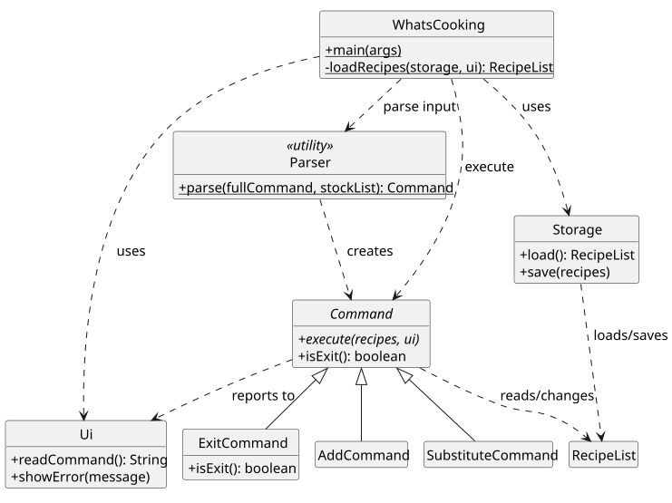

*Figure 1. Main components and their relationships. The eight other `Command` subclasses are grouped
into one box; their members and the model classes' members are omitted.*
[PlantUML source](diagrams/architecture-classes.puml)

Each command word maps to its own `Command` subclass, rather than one class branching on the command word.
`Parser` contains the only `switch`, and each case is a single line, so adding a command means adding a new
file and one line. This also lets team members develop different commands in separate files without
editing the same method. `Parser` and `AppLogger` are utility classes with private constructors because
they keep no state.

`StockList` is created once in `main` and passed through `Parser.parse(fullCommand, stockList)` to
`StockCommand` and `SearchCommand`, which need it. The shorter `Parser.parse(fullCommand)` overload creates
a temporary empty `StockList` and is used by tests that do not involve stock.

#### Main loop

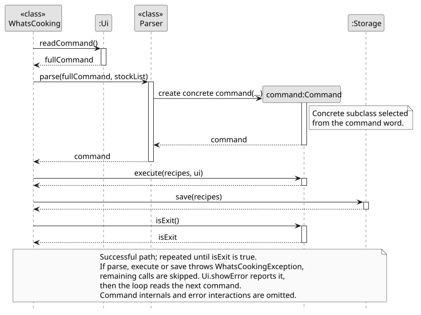

*Figure 2. One iteration of the main loop, for a successful command and for an invalid one. The
calls each command makes to `RecipeList` and `Ui` are covered in the feature sections.*
[PlantUML source](diagrams/main-loop.puml)

1. At startup, `main` creates `Ui`, `Storage` and `StockList`, loads the recipe list through
   `loadRecipes` and shows the welcome message.
2. `Ui.readCommand` returns the next line typed by the user.
3. `Parser.parse` trims the line and splits it at the first space. A blank line and an unknown command
   word both throw a `WhatsCookingException`.
4. The loop calls `command.execute(recipes, ui)`. The command validates its own arguments, updates the
   recipe list if needed and prints its result through `Ui`.
5. `Storage.save` writes the whole recipe list to the data file.
6. If `command.isExit()` returns `true`, the loop ends. Otherwise it returns to step 2.

If step 3, 4 or 5 throws a `WhatsCookingException`, the loop skips the remaining steps, prints the message
with `Ui.showError` and reads the next command. `isExit` is only checked after a successful save, so the
loop ends only when the exit command and the save that follows it both succeed.

#### Error handling, logging and assertions

Errors caused by user input are thrown as `WhatsCookingException` and caught in exactly one place, the main
loop. Commands therefore do not print their own error messages or decide whether to continue; they throw,
and the loop reports the error and continues. Exceptions from the model, such as an
`IllegalArgumentException` from `Recipe`, are converted to `WhatsCookingException` by the command that
receives them, so the message reaches the user instead of ending the program.

By default, Java's logging framework prints records at `INFO` and above to the console, which would mix
developer diagnostics with the recipe output. On its first use, `AppLogger.getLogger` removes the root
logger's console handlers and adds a `FileHandler` that appends to `whatscooking.log` in the working
directory, at `FINE` level and above. If the log file cannot be opened, logging is turned off instead of
falling back to the console. `configureOnce` is `synchronized` and runs only once, so repeated
`getLogger` calls do not attach duplicate handlers.

The main loop logs startup and exit at `INFO` and each reported error at `FINE`. `Parser` logs every command
word at `FINE` and unknown command words at `WARNING`.

Assertions check assumptions that only a programming error could break, for example that
`Parser.parse` never receives `null` and that `RecipeList.add` never receives a `null` recipe. They do not
replace input validation. Gradle `run` and tests enable them; when launching the JAR directly, use
`java -ea -jar whatscooking.jar`.

#### Viewing recipes: `view`

`view` lists every recipe with its number, title, type and serving size, for example
`1. Egg Taco (snack, serves 2)`. `ViewCommand` takes no arguments and calls `Ui.listRecipes`, which prints
`No recipes found.` for an empty list. The text after each number comes from `Recipe.toString`. The command
does not change the recipe list. The numbers it prints are the indexes that `retrieve`, `delete` and `edit`
accept. The [User Guide](UserGuide.md#viewing-all-recipes-view) describes the command.

#### Alternatives and limitations

* **One subclass per command (current) or one class that branches on the command word.** A single class
  would be shorter at first, but every new command would edit the same method, and each command's
  parsing and validation would sit together in one large class.
* **Log file (current) or `FINE`-only logging to the default console handler.** The default handler hides
  `FINE` records, so logging only at `FINE` would also keep the console clean. It was rejected because any
  `WARNING` record would then appear in the user's output.
* **Limitations.**
  * If saving fails, for example because the data file is read-only, `bye` prints the goodbye message
    followed by the save error, and the loop continues instead of exiting.
  * `Ui.readCommand` expects another line of input. If input ends without `bye` (for example, after
    Ctrl+D or at the end of a redirected input file), the application stops with a
    `NoSuchElementException` instead of exiting cleanly.
  * `view` lists recipes in insertion order and cannot sort or page a long list.
  * `whatscooking.log` is appended to on every run and never trimmed.

#### Automated verification

* `ParserTest` covers `bye` and `exit`, dispatch to each command subclass, unknown and blank input, and the
  shared `StockList` being passed to `search`.
* `ExitCommandTest` checks that only the exit command ends the loop.
* `ViewCommandTest` checks that viewing leaves both an empty and a populated recipe list unchanged.
* `RecipeTest` covers the skeleton `Recipe` accessors and defaults.

### Recipe persistence: saving and loading

*Section author: Cheuk Yin ([cheuk-yin](https://github.com/cheuk-yin)).*

Recipes are saved automatically to `data/whatscooking.txt` after every successful command and loaded back
the next time the application starts. The user never runs a save command. The
[User Guide](UserGuide.md#saving-the-data) describes the user-visible behaviour.

#### Responsibilities

| Component | Responsibility |
| --- | --- |
| `Storage` | Converts the recipe list to and from lines of text, and reads and writes the data file. |
| `WhatsCooking` | Calls `load()` once at startup and `save(recipes)` after each successful command. Falls back to an empty list if loading fails. |
| `Recipe`, `Ingredient` | Validate loaded values through the same constructors and setters used by commands. |

`Storage()` uses the default path `data/whatscooking.txt`, relative to the working directory.
`Storage(String filePath)` accepts any path, so tests can use a temporary file without touching the real
save file.

#### File format

Each recipe is written as a fixed sequence of lines, and recipes follow one another with no separator:

```text
TITLE
TYPE                  (empty line if the recipe has no type)
SERVING_SIZE
INGREDIENT_COUNT
QUANTITY              \
UNIT                   } repeated INGREDIENT_COUNT times; UNIT is an empty line if there is none
NAME                  /
STEP_COUNT
STEP                  (repeated STEP_COUNT times)
NOTE                  (empty line if the recipe has no note)
```

For example, `add Egg Taco, snack s/2 i/3 eggs, 100 g cheese st/Scramble st/Wrap` is saved as:

```text
Egg Taco
snack
2
2
3
eggs

100
g
cheese
2
Scramble
Wrap

```

The empty line after `3` is the missing unit of `3 eggs`, and the last line is the empty note.
No delimiters or escaping are needed because every field comes from one line of console input, so no
field can contain a line break. The ingredient and step counts tell `readRecipe` how many lines to read,
so it knows where each recipe ends. The file is also plain text, so a user can read it or copy it to
another computer.

#### Load and save flow

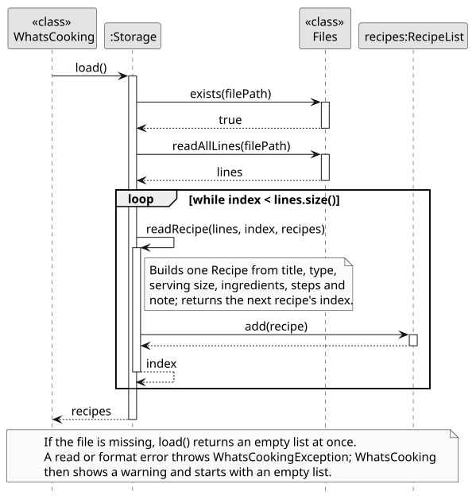

*Figure 3. Loading a data file that exists and is valid. The calls `readRecipe` makes to `Recipe` and
`Ingredient` are omitted; the error paths are described in the text.*
[PlantUML source](diagrams/storage-load-save.puml)

1. `WhatsCooking.loadRecipes` calls `Storage.load()`. If the file does not exist, `load` returns an empty
   `RecipeList` straight away; this is the normal case on the first run.
2. Otherwise, `load` reads every line with `Files.readAllLines`, then calls `readRecipe` repeatedly. Each
   call reads one recipe starting at `index`, adds it to the list and returns the index where the next
   recipe starts. Loading stops when the index reaches the end of the file.
3. `readRecipe` rebuilds the recipe through `new Recipe`, `setServingSize`, `new Ingredient`, `addStep` and
   `setNote`, so loaded values go through the same validation as values entered by the user.
4. After every successful command, `Storage.save` converts the whole list to lines with `writeRecipe`,
   creates the `data` folder if needed and overwrites the file with `Files.write`.

`formatQuantity` writes each quantity with `BigDecimal.stripTrailingZeros().toPlainString()`, so `3.0` is
saved as `3` and very small or large values never appear in scientific notation.

#### Error handling

| Condition | Result |
| --- | --- |
| Data file does not exist | An empty list; `INFO` log entry. No message is shown. |
| Data file cannot be read | `Could not read data file: ...`, then the app starts with an empty list. |
| A count or number cannot be parsed, the file ends in the middle of a recipe, or a value fails validation | `Data file is corrupted: ...`, then the app starts with an empty list. |
| Data file or `data` folder cannot be written | `Could not save recipes to file: ...`. The in-memory list keeps the change. |

`load` catches any `RuntimeException` raised while reading recipes, which includes
`NumberFormatException`, `IndexOutOfBoundsException` and the model's `IllegalArgumentException`, and
rethrows it as a `WhatsCookingException`. `WhatsCooking.loadRecipes` catches that exception, logs a
`WARNING`, shows `Could not load saved recipes, starting with an empty list.` and returns an empty list.
A damaged file therefore never stops the application from starting.

#### Alternatives and limitations

* **Saving in the main loop (current) or inside each command.** Some changes happen in place, for example
  `modify` scaling the quantities of a recipe that is already in the list. If each command had to call
  `save` itself, a command that forgot would lose its changes on exit. Saving centrally covers every
  current and future command. The cost is that read-only commands such as `view` also rewrite the file,
  which is negligible for a personal recipe collection.
* **Line-based text (current) or JSON/CSV.** JSON would need a third-party library, and CSV would need
  escaping for commas, which are common in ingredient lists. The fixed-line format needs neither.
* **Rewriting the whole file (current) or appending changes.** Rewriting keeps the file identical to the
  in-memory list after deletes and edits, at the cost of writing every recipe each time.
* **Limitations.**
  * Quantities are saved as decimals and reloaded as `double`, so the exact fractions used by `modify`
    (see [Serving-size modification](#serving-size-modification-modify)) are not preserved after a
    restart.
  * Only recipes are saved. Items added with `stock` are lost when the application exits.
  * When a corrupted file is replaced with an empty list, the next successful command overwrites the
    file. Copy the file before entering another command if its contents need to be recovered.
  * Loading does not check for duplicate titles, so a hand-edited file can introduce two recipes that
    `add` would have rejected.

#### Automated verification

* `StorageTest` covers a missing file, a save/load round trip that restores every field of several
  recipes, creation of a missing parent folder, and a corrupted file.
* `PersistenceWorkflowTest` runs the real CLI as two separate processes in one temporary folder and checks
  that a recipe added in the first session is listed by `view` in the second.

### Serving-size modification: `modify`

*Section author: CAO JINGYUAN ([littlecrawler](https://github.com/littlecrawler)).*

`modify RECIPE_NAME s/NEW_SERVING_SIZE` resizes an existing recipe. It multiplies each ingredient
quantity by the target serving size divided by the current serving size. For example, changing a
two-serving recipe containing 2 eggs and 100 g cheese to four servings produces 4 eggs and 200 g
cheese. Ingredient names, units, recipe title, type, preparation steps and note remain unchanged.
The [User Guide](UserGuide.md#modifying-a-recipe-modify) describes the command syntax and output.

#### Responsibilities and quantity representation

The command handles user input and reporting; the recipe model owns the calculation and update.
This keeps the resizing rules available to callers other than the CLI.

| Component | Responsibility |
| --- | --- |
| `Parser` | Recognizes `modify` and passes the remaining arguments to `ModifyCommand`. |
| `ModifyCommand` | Validates the name/size arguments, locates the recipe, handles an unchanged size and reports success or errors. |
| `RecipeList` | Finds the first recipe whose full title matches, ignoring case and surrounding whitespace. |
| `Recipe` | Calculates and validates every new quantity before applying any changes. |
| `Ingredient` | Keeps the immutable name and unit separate from the replaceable quantity; formats quantities for output. |
| `IngredientQuantity` | Stores an exact fraction and returns new, reduced fractions when scaling. This class is package-private and immutable. |
| `Ui` | Displays the previous and new serving sizes and the updated ingredient list. |

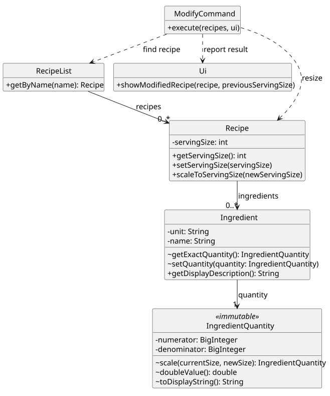

*Figure 4. Classes involved in resizing. Only relevant members and relationships are shown;
`~` indicates package-private access.*
[PlantUML source](diagrams/modify-classes.puml)

An ingredient's quantity is an `IngredientQuantity`, represented by positive `BigInteger` numerator
and denominator fields. Decimal input is converted through `BigDecimal` without first rounding the
stored value to a `double`. Scaling creates a new fraction:

```text
new numerator   = current numerator   * new serving size
new denominator = current denominator * current serving size
```

The constructor divides both terms by their greatest common divisor. This preserves exact values
across successive changes while reducing the size of the integers. For example, 1 kg of rice for
three servings becomes exactly 1/3 kg for one serving. Its display is `0.33 kg rice`, but changing
back to three servings in the same session restores exactly `1 kg rice`.

`IngredientQuantity.toDisplayString()` displays terminating decimals in full, removing trailing
zeroes. It rounds a repeating decimal to at most two places using `HALF_UP`. Displayed text is never
fed back into the resizing calculation. `doubleValue()` is used only for the existing numeric API
and range validation; it is not the source of subsequent scaling calculations.

#### Command flow and update order

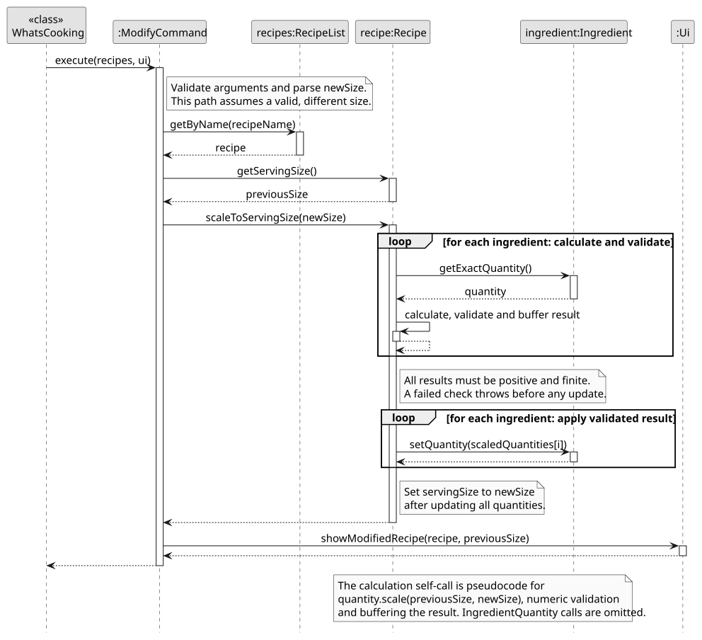

*Figure 5. A valid command that changes the serving size. Parsing, unchanged-size handling,
exception paths and the application's subsequent save are described in the text and omitted here.*
[PlantUML source](diagrams/modify-serving-size.puml)

1. `ModifyCommand.execute` splits the arguments at a whitespace-delimited `s/`. It requires one
   name and one size, and parses the size as an integer from 1 to `Integer.MAX_VALUE`.
2. `RecipeList.getByName` resolves the full recipe name. A missing recipe produces a user-facing
   error. If the requested size already equals the current size, the command reports no change.
3. `Recipe.scaleToServingSize` allocates a temporary array. For every ingredient, it calculates an
   exact new quantity and checks that its numeric approximation remains positive and finite.
4. Only after all quantities pass validation does a second loop replace the ingredient quantities.
   The method then updates the recipe's serving size. It retains the existing ingredient objects.
5. The command logs the successful resize at `FINE` level and calls `Ui.showModifiedRecipe`.

The two loops prevent a later invalid quantity from leaving earlier ingredients partly resized.
For example, if the last ingredient overflows, the exception occurs before any quantity or serving
size is changed. An empty ingredient list is valid: only its serving size changes. The algorithm
makes two passes over I ingredients and uses I temporary quantity references, in addition to the
integer arithmetic needed for each exact fraction.

#### Validation and error handling

| Condition | Result |
| --- | --- |
| Missing name/size or repeated `s/` | A usage error before any recipe is changed. |
| Zero, negative, decimal, non-numeric or overflowing serving size | `Serving size must be a positive integer.` |
| No matching full recipe name | A recipe-not-found error; partial names do not match. |
| Target equals current size | A no-change message; quantities remain untouched. |
| A scaled quantity overflows to infinity or underflows to zero | An error with every original quantity and the original serving size preserved. |

Assertions check internal assumptions, including non-null command dependencies and positive
fraction terms. Runtime validation handles user input even when assertions are disabled.
`ModifyCommand` converts model `IllegalArgumentException`s to `WhatsCookingException`s, which the
application loop catches and displays before accepting the next command.

#### Integration, alternatives and current limits

`setServingSize` and `scaleToServingSize` serve different purposes. `add ... s/2` and loading a saved
recipe use the setter to record the serving size for the supplied quantities. `modify ... s/4`
uses the scaler to resize those quantities by 4 / 2. Substituting the setter for the scaler would
leave the ingredient amounts inconsistent with the requested number of servings.

`WhatsCooking` saves recipes after a command returns successfully, including `modify`. The current
`Storage` implementation writes `Ingredient.getQuantity()` as a decimal and reloads it as a `double`.
Consequently, exact fractions and decimal digits beyond double precision are not preserved across
a save/restart boundary. The exact round-trip guarantee above applies within a running session;
preserving it across restarts would require a coordinated change to the quantity storage format.

Using only `double` quantities would be simpler, but repeated resizing could accumulate rounding
errors. Rounding each result to two decimal places before storing it would also lose information
needed by later commands. Exact fractions keep calculation separate from display. Updating each
ingredient immediately would avoid the temporary array but could leave a partially modified recipe
when a later ingredient fails validation.

#### Automated verification

* `ModifyCommandTest` covers parser dispatch, full-name matching, unchanged sizes, invalid syntax,
  numeric boundaries, missing recipes and reporting a failed resize without a partial update.
* `RecipeScalingTest` covers successive resizing, preserved recipe details and ingredient objects,
  exact fractions, empty recipes, and overflow/underflow without changes to the original recipe.
* `IngredientDisplayTest` covers finite decimal precision, repeating decimals and display rounding.
* `ModifyWorkflowTest` checks the complete CLI session against `text-ui-test/EXPECTED.txt`.
* `ServingSizeCompatibilityTest` checks that `add` establishes the size used by later `modify` calls.

### Recipe filtering: `search`

*Section author:  NATHAN BONG NENG QUAN ([NUS-Nbnq]https://github.com/NUS-Nbnq).* 

The `search` command selects recipes using one or more filters. Each filter has the form
`f/{field}/{keyword}`, where `field` is `name`, `ingredient`, or `stock`. For example,
`search f/name/chicken f/ingredient/tomato` returns recipes whose titles contain `chicken` and
whose ingredients contain `tomato`. The [User Guide](UserGuide.md) describes the command syntax and
user-visible output. This section focuses on the filter objects and their factory; `SearchCommand`
is responsible only for applying the resulting filters and displaying the matches.

#### Filter responsibilities and class structure

`Filter` defines the common `matches(Recipe)` operation. Each concrete filter owns one matching
rule, which keeps field-specific logic out of `SearchCommand` and makes each rule independently
testable.

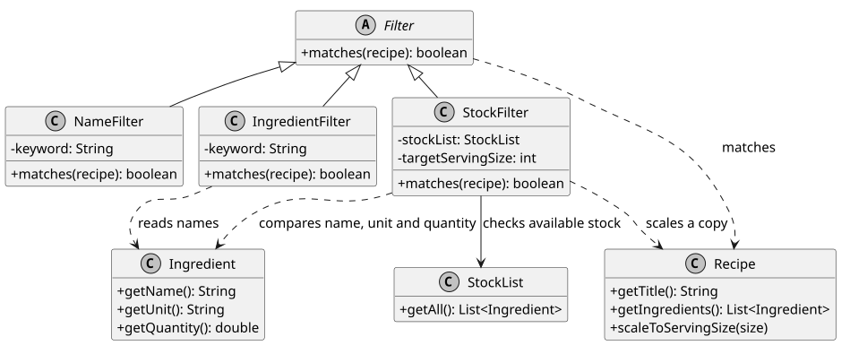

*Figure 5. The filter hierarchy and the model objects read by each implementation.*
[PlantUML source](diagrams/search-filter-classes.puml)

| Component | Responsibility |
| --- | --- |
| `Filter` | Defines the common recipe-matching contract. |
| `NameFilter` | Performs a case-insensitive substring search on the recipe title. |
| `IngredientFilter` | Performs a case-insensitive substring search on every ingredient name and succeeds on the first match. |
| `StockFilter` | Scales a copy of the recipe to the requested serving size, then checks whether stock contains enough of every required ingredient. |
| `StockList` | Supplies the current stock entries; it is read but not modified by a filter. |
| `SearchCommand` | Applies every filter to each recipe, retaining a recipe only when all filters match. |

`NameFilter` and `IngredientFilter` lowercase both the stored keyword and the value being checked.
They use substring matching rather than exact matching, so `f/name/chick` matches `Chicken Pasta`.
`IngredientFilter` checks ingredient names only; quantity and unit text are not searched separately.
An empty recipe therefore cannot satisfy an ingredient filter.

`StockFilter` does not mutate the recipe being searched. It creates a temporary recipe containing
the original ingredients, scales that copy to `targetServingSize`, and then compares every scaled
ingredient with the entries returned by `StockList.getAll()`. Names and units are compared without
regard to case. Matching stock entries are accumulated, so separate stock entries with the same
name and unit can satisfy one requirement together. A recipe matches only if the accumulated
quantity is sufficient for every required ingredient; a small `0.0001` tolerance accounts for
floating-point representation. Scaling may throw an `IllegalArgumentException` for an invalid
recipe serving size or target size, which is propagated through the filter contract.

#### Filter creation and validation

`FilterFactory` is a stateless utility class. It receives the raw search arguments and the active
`StockList`, then returns an `ArrayList<Filter>` in the same order as the input tokens. The factory
also performs all syntax validation before `SearchCommand` starts scanning recipes.

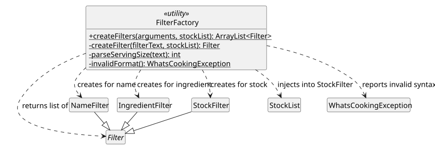

*Figure 6. `FilterFactory` validates filter syntax and selects the concrete filter class.*
[PlantUML source](diagrams/filter-factory-classes.puml)

The factory first rejects an empty argument string. It splits the remaining input on whitespace,
so extra spaces are harmless. Each token must start with `f/` and contain exactly a non-blank field
and keyword after splitting at most twice on `/`. The field selects the implementation:

| Input field | Created object | Keyword interpretation |
| --- | --- | --- |
| `name` | `NameFilter` | Case-insensitive title substring |
| `ingredient` | `IngredientFilter` | Case-insensitive ingredient-name substring |
| `stock` | `StockFilter` | Positive integer requested serving size |

For `stock`, the factory parses the keyword as a positive `int` and injects the active `StockList`
into the new filter. Unknown fields, malformed structure, blank values, non-numeric serving sizes,
zero, negative values, and integers outside the `int` range are converted to user-facing
`WhatsCookingException`s with stable messages. This keeps parser errors at the boundary and avoids
partially executing a search with an invalid filter.

#### Search evaluation and complexity

`SearchCommand.internalExecute` asks the factory for the filters, then visits each recipe in list
order. For each recipe it evaluates filters in input order and stops at the first failure. This
short-circuiting preserves the AND semantics while avoiding unnecessary matching work. Matching
recipe indices are returned in their original order; `execute` formats those recipes through `Ui`.

If there are R recipes and F filters, the outer search performs at most R x F filter calls. Name
and ingredient filters scan the title or ingredient list. A stock filter scans the recipe's I
ingredients and the S stock entries, giving O(I x S) matching work for that recipe in the current
implementation. The lists are expected to be small, so direct scans keep the design simple and
avoid maintaining a separate index that could become stale after stock changes.

#### Automated verification

* `FilterTest` checks case-insensitive name and ingredient matching, stock scaling, insufficient
  stock, and invalid serving sizes.
* `SearchTest` checks empty results, output, multiple-filter AND semantics, and whitespace handling.
* `ParserTest` checks that the application supplies the active `StockList` to a stock search.

The diagrams intentionally omit private implementation details of `Recipe`, `Ingredient`, and
`StockList`. Their public operations are shown only where they explain a filter's dependency or
matching behavior.

### Built-in allergen checking (v2.0)

*Section author: CAO JINGYUAN ([littlecrawler](https://github.com/littlecrawler)).*

This enhancement helps users notice possible allergens while managing recipes. A successful `add`
prints a warning when a recorded ingredient name matches the built-in dictionary. `retrieve` prints
the same warning with the recipe's details, whether the recipe is selected by its index or full name.
The recipe is still added or displayed normally: a match is advisory and does not reject the command.
This section covers the allergen checker and its integration with the existing commands; it does
not describe the full implementation of recipe creation or retrieval.

The feature checks nine categories: milk, eggs, fish, crustacean shellfish, tree nuts, peanuts, wheat,
soybeans and sesame. These categories define the scope of the feature, not an exhaustive claim about
food allergies. The [User Guide](UserGuide.md#built-in-allergen-warnings) contains the complete keyword
list, command examples and user-visible limitations.

#### Responsibilities and data model

The feature separates matching from console formatting so the same rules can be reused and tested
without running the application loop.

| Component | Responsibility |
| --- | --- |
| `Allergen` | Defines each category's display name and immutable list of English keywords; matches a name against those keywords. |
| `AllergenChecker` | Examines the supplied `Ingredient` objects and returns the distinct matching categories. It has no recipe-specific state. |
| `Ingredient` | Supplies the name separately from its quantity and unit, so quantities and measurement units are not scanned. |
| `Ui` | Formats the warning consistently for a newly added recipe and a retrieved recipe. |
| `AddCommand` | Calls `Ui.showAllergenWarnings(recipe)` only after input validation and successful insertion. |
| `RetrieveCommand` | Uses the existing `Ui.showRecipe` overloads; both eventually display one `Recipe` and its warning. |

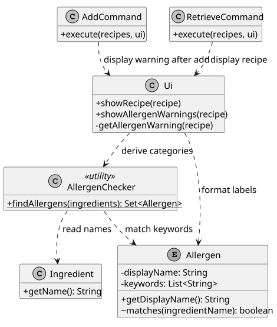

*Figure 6. Dependencies relevant to allergen checking. Unrelated members and classes are omitted.*
[PlantUML source](diagrams/allergen-classes.puml)

No allergen flag is stored in `Recipe` or in the save file. `AllergenChecker.findAllergens` derives a
new result from the current ingredient names each time it is called. Consequently, recipes loaded by
`Storage` receive the same check as newly created recipes, and scaling quantities does not invalidate
the result. Existing files remain compatible because the feature adds no persistent fields. The
returned set is unmodifiable; callers cannot mutate a result or use it to change a recipe.

#### Matching rules

`Allergen.matches` converts an ingredient name to lowercase using `Locale.ROOT`, then replaces runs
of non-letter/non-digit characters with a space. Using a fixed locale makes matching independent of
the computer's language settings. Punctuation and repeated whitespace therefore separate words;
for example, `BRAZIL-NUTS` becomes `brazil nuts`.

The normalized name and each keyword are compared with spaces around their boundaries. This allows
`roasted peanuts` to match `peanuts` without allowing `egg` to match `eggplant`. Singular and plural
forms are listed explicitly; the implementation does not guess word stems or interpret ingredient
semantics. An ingredient may match several categories, and several ingredients may match the same
category. An `EnumSet` removes duplicates and preserves category declaration order, producing stable
output such as `Possible allergens: milk, eggs. Check ingredient labels.`

For I ingredients and a fixed dictionary containing K keywords in total, the checker performs at
most I x K substring checks after normalization. Both the dictionary and typical recipe lists are
small, so a direct loop is sufficient. A search index or external service would add complexity with
little benefit for this version.

#### Sequence: allergen checking during `retrieve`

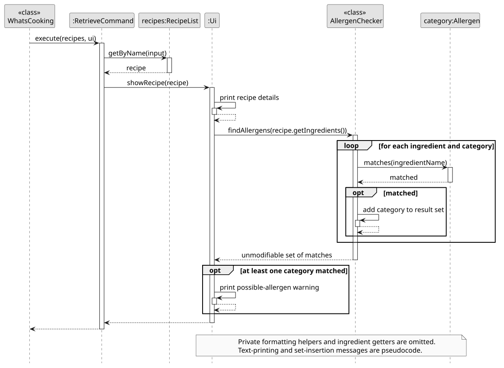

*Figure 7. The allergen check triggered by successful retrieval by full name. Parsing, private
formatting helpers and ingredient getters are omitted to keep attention on the allergen check.*
[PlantUML source](diagrams/allergen-retrieve.puml)

1. The application dispatches `RetrieveCommand.execute(recipes, ui)`.
2. The command obtains the recipe using `RecipeList.getByName` and asks `Ui` to display it.
3. `Ui` prints the recipe details. Its private formatting helper passes `recipe.getIngredients()`
   to `AllergenChecker.findAllergens`.
4. For each ingredient and category, the checker compares the ingredient name with that category's
   keywords and collects matching categories.
5. The checker returns an unmodifiable set. `Ui` prints one warning line if the set is non-empty.
   If there are no matches, the ordinary recipe output is unchanged.

Retrieval by index first uses `Ui.showRecipe(recipes, index)`, which resolves the recipe and delegates
to `Ui.showRecipe(recipe)`. It therefore uses exactly the same warning path. During `add`, validation
and insertion finish before `Ui.showAllergenWarnings(recipe)` invokes the shared formatting helper.
A malformed ingredient or duplicate title throws before that point, so a rejected recipe produces
neither a success message nor an allergen warning.

#### Defensive programming and integration

User input continues through the existing validation and `WhatsCookingException` path. Assertions
guard internal assumptions: the checker requires a non-null ingredient list with non-null entries,
and the UI requires a recipe. These assertions document programming errors; they do not replace
validation of user input. Java assertions are enabled for Gradle `run` and tests. When launching the
packaged application directly, use `java -ea -jar whatscooking.jar` to enable them as well.

The checker logs the number of matched categories and examined ingredients at `FINE` level through
`AppLogger`. The application directs logs to a file rather than the CLI output. Logging does not
change a recipe or store detection results.

The agreed `s/` contract is also verified: `add ... s/2` records the initial serving size without
rescaling the supplied quantities; `modify ... s/4` then scales those quantities by 4 / 2. Both
commands accept positive whole numbers up to `Integer.MAX_VALUE` and reject invalid or overflowing
values. Allergen detection uses names only, so this interaction preserves the warnings.

#### Alternatives and limitations

Storing detected categories in each recipe would make reads cheaper, but would require updating the
flags after every ingredient edit and migrating the save format. Deriving results avoids those
consistency problems. Keeping separate matching code inside `add` and `retrieve` was also avoided
because the two commands could otherwise develop different dictionaries or matching rules.

A fixed keyword list is easy to inspect, test and run offline. Its tradeoff is limited understanding:
it misses unlisted names and hidden ingredients, and it does not understand negation or substitutes.
For example, `coconut milk` matches milk and `peanut butter` matches both milk and peanuts. These are
literal name matches, not findings about the food's composition. No output should describe an
unmatched recipe as safe or allergen-free. Only ingredient names are checked; notes and preparation
steps may mention food that the checker does not see.

The planned v2.0b substitution feature is outside this implementation. A future change must define
and test its own replacement rules; the absence of a keyword match cannot establish that a proposed
replacement is safe.

#### Automated verification and diagram maintenance

* `AllergenCheckerTest` covers every category, aliases, case and punctuation, word boundaries,
  duplicates, stable ordering, empty and unrecognised input, literal substitute/negation handling,
  locale independence and fresh immutable results after recipe changes.
* `AllergenWorkflowTest` launches the real CLI in temporary directories. It checks successful add,
  retrieval by index and name, rejected additions, ignored titles/notes/steps, recipes without
  ingredients, and warnings after saving, restarting and scaling.
* `ServingSizeCompatibilityTest` checks the `add`/`modify` contract and invalid numeric boundaries.
* The existing `ModifyWorkflowTest` retains exact console-output checks; its expected output includes
  the two new warning lines in the fixture session.

Run `./gradlew check` on macOS/Linux or `.\gradlew.bat check` on Windows with Java 25. This runs the
JUnit suite and Checkstyle. Diagrams are committed as SVG so GitHub and the published DG can display
them without a PlantUML plugin. After changing a `.puml` source, regenerate its SVG with
`java -jar /path/to/plantuml.jar -tsvg docs/diagrams/*.puml` and inspect the rendered result.

### Stock management: `stock`

*Section author: Jiang Siyu ([irisiyuj](https://github.com/irisiyuj))*

The `stock` command manages the ingredients the user currently has at home. It allows adding items (`stock add`), removing consumed items (`stock remove`), and viewing the current inventory (`stock list`). Unlike recipes, which store a fixed list of required ingredients, the stock is a mutable collection that grows and shrinks. The feature ignores plural forms to improve usability, tracks expiry dates, and ensures items cannot be removed if the user does not have enough. The [User Guide](UserGuide.md#managing-home-stock-stock) describes the command syntax and output.
#### Responsibilities and data model

The feature separates the inventory management from command parsing, allowing the underlying data structure to be tested independently of the console loop.

| Component | Responsibility                                                                                                                                          |
| --- |---------------------------------------------------------------------------------------------------------------------------------------------------------|
| `StockList` | Holds an `ArrayList` of `Ingredient` objects. Provides the logic to add, merge, and remove items. It normalizes names to match singular and plural forms. |
| `StockCommand` | Parses the `action` (add, remove, list) and `data`. It handles command-level validation and passes structured `Ingredient` objects to `StockList`.      |
| `StockItem` | Wraps an `Ingredient` and an optional `LocalDate` expiry date. It provides methods to check if an item is expired or expiring soon.                     |
| `Ingredient` | Reused from the recipe module. It supplies the quantity, unit and name for the stock operations.                                                        |
| `Parser` | Recognizes the `stock` keyword and instantiates the `StockCommand` with the shared `StockList`.                                                         |

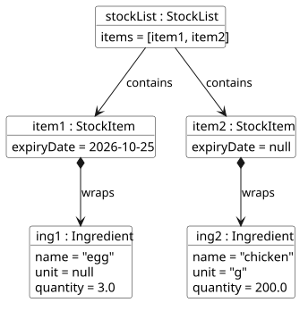

*Figure 8. The in-memory state of `StockList` after adding "3 eggs" and "200g chicken". Unrelated members are omitted.*

Unlike `Recipe`, the `StockList` does not maintain serving sizes. It relies on an `ArrayList` to preserve insertion order. The `Ingredient` objects stored within `StockItem` are mutable only in their quantity; their name and unit remain final.


#### Implementation details

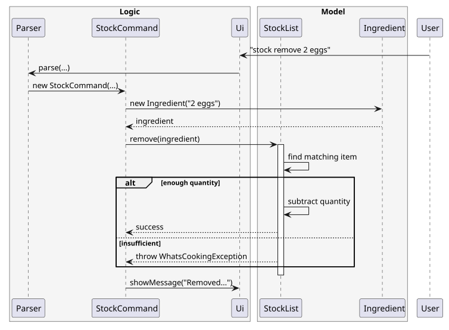
*Figure 9. A valid `stock remove` command that successfully subtracts quantities. Exception paths and the application's subsequent save are omitted.*

1. `StockCommand.execute` splits the arguments into an `action` and the remaining `data`. For `add`, it checks for the ` by/` prefix to extract and parse the expiry date using `LocalDate.parse()`.
2. If the date format is invalid, a `DateTimeParseException` is caught and rethrown as a user-facing `WhatsCookingException`.
3. For `add`, `StockList` attempts to find an existing `StockItem` with matching name, unit, and expiry date. If found, quantities are summed. If the expiry dates differ, the new item is appended as a separate entry.
4. For `remove`, the `StockList` collects all matching items and **sorts them by expiry date (earliest first, null dates last)**. It then subtracts the requested quantity from the earliest-expiring items first.
5. If a removal empties an item's quantity, it is deleted. The command logs the operation and calls `Ui` to display the updated list with `[EXPIRED]` or `[EXPIRING SOON]` tags.

#### Expiry tracking and floating-point safety

The `StockItem` uses `LocalDate.now()` to determine its state. An item is flagged as `[EXPIRED]` if its date is before today, and `[EXPIRING SOON]` if it expires within the next 3 days. This prevents food waste by visually alerting the user.

When removing items, the implementation calculates `newQuantity = item.getQuantity() - toRemove.getQuantity()`. Because Java uses floating-point arithmetic for `double`, an exact subtraction like `5.0 - 5.0` might theoretically result in `0.000000001`. To prevent leaving ghost items, the code checks `if (newQuantity <= 0.0001)` before deleting. Otherwise, it updates via `setQuantity`.


#### Alternatives and limitations

Storing stock as plain strings (e.g., "3 eggs") was considered but rejected. Numeric operations (adding and subtracting) would require re-parsing every time, which is error-prone. Reusing the `Ingredient` class ensures strict type checking.

A limitation of this implementation is the lack of automatic unit conversion. If the user adds `1 kg chicken` and attempts to remove `500 g chicken`, the command will fail because the units differ. Implementing unit conversion (kg to g, liters to ml) was deemed out of scope for v1.0 to prevent complexity. Additionally, the plural-normalization only strips trailing 's' and does not handle irregular plurals (e.g., "mice" to "mouse").

#### Defensive programming and integration

Assertions guard internal assumptions: `StockList` asserts that the incoming `Ingredient` is not null. User input errors are handled separately via `WhatsCookingException` and displayed by the `Ui`. The `StockList` is instantiated once in `WhatsCooking` and passed via the `Parser` to avoid static state, keeping the class testable. Data persistence handles `LocalDate` by serializing it to a string (or "NONE") during save/load.

#### Automated verification

* `StockListTest` covers successful additions, merging identical items, case-insensitivity, plural matching, exact removals, partial removals, and exceptions for insufficient stock.
* `StockCommandTest` verifies the command parsing, missing arguments, invalid ingredient formats, and correct delegation to `StockList`.
* Manual testing instructions for the stock feature are included in the section [Instructions for manual testing](#instructions-for-manual-testing).

### Recipe creation and editing: `add` and `edit`

*Section author: Lim Sin ([wunicorn21](https://github.com/wunicorn21)).*

`add` creates a recipe from one line of input, and `edit` changes the title, type or note of an existing
recipe. In v2.0, `add` also rejects a title that another recipe already uses (ignoring case and surrounding
spaces) and accepts an optional serving size with `s/`. Both commands accept the same kinds of values, so the
rules for checking those values are kept in one shared class. The
[User Guide](UserGuide.md#adding-a-recipe-add) describes the command syntax and output.

#### Classes involved

`AddCommand` and `EditCommand` decide the order and meaning of their arguments, while the shared checks for
individual values (title, type, serving size, ingredients, steps and note) live in the utility class
`RecipeInputParser`. This keeps both commands' error messages identical and avoids duplicated parsing code.
`RecipeList.containsTitle` keeps titles unique, and `Recipe.setTitle` and `Recipe.setType` were added for `edit`.

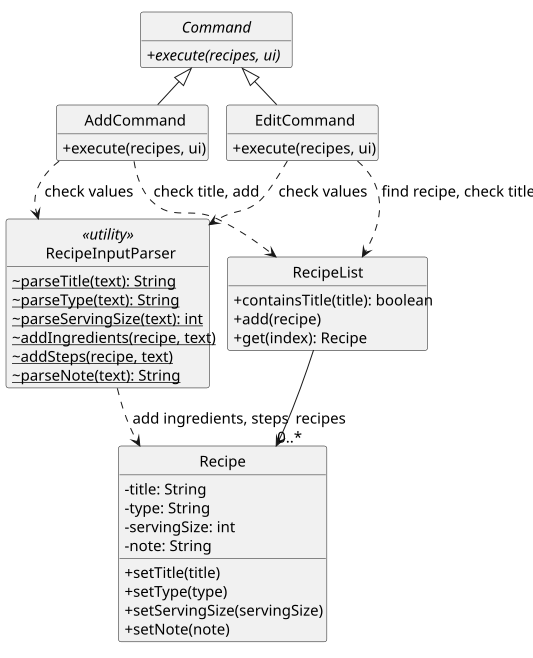

*Figure 10. Classes involved in `add` and `edit`. Only relevant members and relationships are shown;
`~` indicates package-private access and underlined methods are static.*
[PlantUML source](diagrams/recipe-input-classes.puml)

#### Command flow: `add`

The format is `add TITLE[, TYPE] [s/SERVINGS] [i/INGREDIENTS] [st/STEP]... [n/NOTE]`.

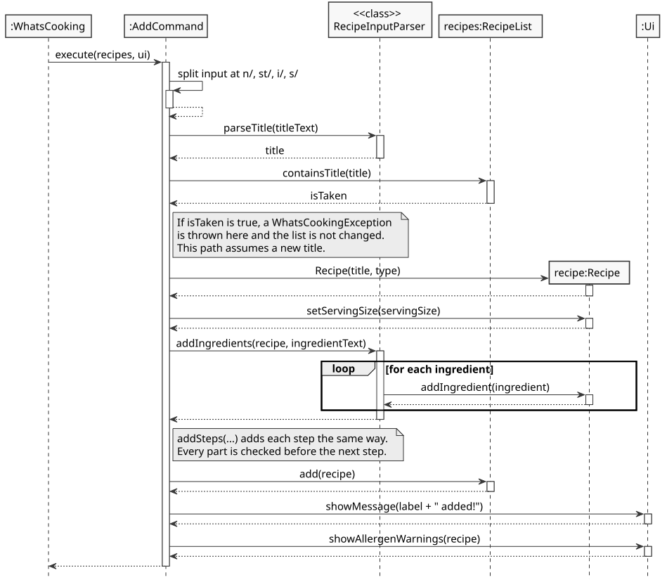

*Figure 11. A valid `add` command with a new title. Parsing by `Parser`, exception paths and the
application's subsequent save are described in the text and omitted here.*
[PlantUML source](diagrams/add-recipe.puml)

1. `AddCommand.execute` adds a leading space to the arguments, then splits them from the back: first at
   ` n/`, then at the first ` st/`, then at ` i/`, then at ` s/`, and finally at the first comma to separate
   the title from the type. Each prefix includes its leading space, so text such as `wasabi/` inside an
   ingredient is not mistaken for a prefix.
2. `RecipeInputParser.parseTitle` trims the title and rejects a blank one.
3. `RecipeList.containsTitle` compares the title with every stored title, ignoring case and surrounding
   spaces. A match throws a `WhatsCookingException` before any `Recipe` is created.
4. The command creates the `Recipe`, records the serving size with `setServingSize` (without scaling any
   quantity), and adds the ingredients and steps through `RecipeInputParser`.
5. Only after every part is valid does it call `RecipeList.add`. It then shows the confirmation and any
   possible-allergen warning through `Ui`. `WhatsCooking` saves the list after the command returns.

#### Command flow: `edit`

The format is `edit INDEX [title/NEW_TITLE] [type/NEW_TYPE] [n/NEW_NOTE]`. Unlike `add`, the parts may be
given in any order. `EditCommand` records where each prefix starts, sorts those positions, and takes each
value as the text up to the next prefix or the end of the line.

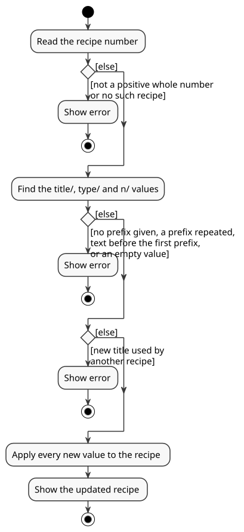

*Figure 12. The checks `edit` makes, in order. Every check finishes before any value is changed.*
[PlantUML source](diagrams/edit-recipe-activity.puml)

1. The recipe number is parsed as a positive whole number and resolved with `RecipeList.get`.
2. The values for `title/`, `type/` and `n/` are found. A missing prefix leaves that field unchanged.
3. Each new value is checked with `RecipeInputParser`. A new title must not belong to another recipe;
   changing only the letter case of the recipe's own title is allowed.
4. Only then are the new values applied with `setTitle`, `setType` and `setNote`, and the updated recipe
   is displayed.

Checking everything before changing anything means a rejected `edit` leaves the recipe exactly as it was.
The prefix `type/` is used instead of `t/` because `t/` is reserved for a planned cooking-time field.

#### Alternatives and limitations

* **One-line input (current) or a guided, multi-step dialogue.** Early drafts of `add` asked for ingredients,
  then steps, then a note, ending each stage with `done!`. A single line was chosen because it is faster for
  users who type well, matches the other commands, and needs no stored state between inputs. Its cost is that
  long recipes produce long lines and the parts of `add` must be typed in order.
* **Shared checks (current) or checks inside each command.** Keeping separate copies in `add` and `edit`
  would let the two commands drift apart. The planned editing of ingredients and steps can reuse
  `addIngredients` and `addSteps` directly.
* **Selecting a recipe by number (current) or by title in `edit`.** A number is short and never ambiguous,
  whereas a title can contain text that looks like a prefix.
* **Limitations.** Extra spaces inside a title are significant, so `egg  taco` (two spaces) is not treated
  as a duplicate of `egg taco`. `edit` cannot yet change ingredients, steps or remove a type; these are
  planned for v2.0b.

## Product scope
### Target user profile

Home cooks who prefer a command-line interface for storing, finding and adjusting their recipes, as well as managing the ingredients they currently have at home.

### Value proposition

Keep recipe details in a local collection, find them quickly, resize quantities for a different
number of servings, and surface possible allergens named in the recorded ingredients, , and keep track of available ingredients to know what can be cooked right now.

## User Stories

|Version| As a ... | I want to ... | So that I can ...|
|----|---------|---------------|------------------|
|v1.0|home cook|resize a recipe's ingredient quantities for a new serving size|cook for a different number of people without calculating each amount manually|
|v1.0|home cook| retrieve a specific recipe by its index or name | view its full details quickly without scrolling through the whole list |
|v1.0|home cook| delete a recipe by its index or name | remove outdated or disliked recipes to keep my collection clean |
|v1.0|home cook|view a list of all my recipes|see what I have saved and find the number of the recipe I want|
|v1.0|home cook|have my recipes saved automatically|keep them after closing the application without remembering to save|
|v2.0|home cook|see possible allergens when adding or retrieving a recipe|know which recorded ingredients need further checking|
|v2.0|home cook| add, remove, and list ingredients I currently have at home | keep track of my inventory and know what I can cook right now |
|v2.0|frequent user|be stopped from adding a recipe whose title I already used|avoid keeping two different versions of the same dish|
|v2.0|host|record how many people a recipe serves when I add it|scale it correctly with `modify` later|
|v2.0|frequent cook|edit a recipe's title, type or note|keep my recipes up to date without deleting and re-adding them|

## Non-Functional Requirements

* An invalid resize must leave the original recipe unchanged; successful resizing must preserve its other details.
* Within a running session, quantity display rounding must not affect later resizing calculations.
* Allergen checking runs offline, without third-party runtime dependencies or a remote database.
* Detection must leave the recipe and its quantities unchanged and use a stable display order.
* The feature must work with the existing plain-text save format and Java 25 application.
* A rejected `add` or `edit` must leave the recipe list exactly as it was before the command.
* Recipe titles must stay unique (ignoring case), including for recipes loaded from a previous session.
* A missing, unreadable or corrupted data file must not stop the application from starting.
* The data file must be plain text that a user can read and copy to another computer.
* Log output must never appear in the console alongside the application's output.

## Glossary

* *Serving size* - The number of people for whom the recorded ingredient quantities are intended.
* *Exact quantity* - A quantity represented internally as a fraction rather than rounded display text.
* *Possible allergen* - A category whose configured keyword matches an ingredient name; this does not
  establish the actual composition of the ingredient.
* *Derived result* - A value recalculated from current recipe data instead of stored independently.
* *Stock* - The collection of ingredients the user currently has at home.
* *Prefix* - The short marker before a part of a command, such as `s/`, `i/`, `st/`, `n/`, `title/` or `type/`.
* *Duplicate title* - A title that matches an existing recipe's title when letter case and surrounding spaces
  are ignored.
* *Command word* - The first word of a line of input, such as `add` or `view`, which selects the command to run.
* *Data file* - The plain-text file `data/whatscooking.txt`, which holds the saved recipes.

## Instructions for manual testing

Run a built JAR in a separate test folder so these examples do not affect your personal recipe file.
Build it with `./gradlew shadowJar` (Windows: `.\gradlew.bat shadowJar`), copy
`build/libs/whatscooking.jar` into that folder, and launch `java -ea -jar whatscooking.jar`.

### Serving-size modification

Run these actions in order, starting without a recipe named `Resize Rice`. Keep the application
running between the fraction round-trip steps so this checks the in-memory calculation.

| Action | Expected observation |
| --- | --- |
| `add Resize Rice, main s/3 i/1 kg rice st/Cook n/Keep covered` | Recipe added for three servings. |
| `modify resize rice s/1` | Full-name lookup ignores case; the ingredient displays as `0.33 kg rice`. |
| `modify Resize Rice s/3`, then `retrieve Resize Rice` | Quantity returns to exactly `1 kg rice`; title, type, unit, step and note remain unchanged. |
| `modify Resize Rice s/3` | No-change message. |
| `modify Resize Rice s/0`, `modify Resize Rice s/1.5` and `modify Resize Rice s/2147483648` | Each is rejected with the positive-integer error. |
| `modify Resize Rice s/2 s/4` | Usage error for repeated parameters. |
| `modify Resize s/2` | Recipe-not-found error; a partial name is not accepted. |
| `retrieve Resize Rice` | Still three servings and `1 kg rice` after the rejected commands. |

### Allergen warnings

| Action | Expected observation |
| --- | --- |
| `add Omelette, breakfast s/2 i/2 eggs, 100 g cheese st/Cook` | Recipe added; warning lists `milk, eggs` once each. |
| `retrieve 1` and `retrieve omelette` | Both show the recipe and the same warning. |
| `modify Omelette s/4`, then `retrieve 1` | Quantities are 4 eggs and 200 g cheese; warning still lists `milk, eggs`. |
| `bye`, restart in the same folder, then `retrieve 1` | The saved recipe and its warning reappear. |
| `add Invalid i/1 eggs, 0 g cheese` | Input error; no recipe or warning is added for the failed command. |
| `add Roast i/1 eggplant`, then `retrieve Roast` | No allergen warning; `egg` must not match inside `eggplant`. |
| `add Empty`, then `retrieve Empty` | Empty ingredient list displays normally with no warning. |
| `add Drink i/1 cup coconut milk` | Literal keyword matching warns about milk; it cannot interpret substitutes. |

### Viewing and saving recipes

Run these actions in order in an empty test folder, so no data file exists yet.

| Action | Expected observation |
| --- | --- |
| `view` | `No recipes found.` |
| `add Egg Taco, snack s/2 i/3 eggs st/Cook`, then `view` | Lists `1. Egg Taco (snack, serves 2)`. A `data` folder containing `whatscooking.txt` appears. |
| `bye`, restart in the same folder, then `view` | `Egg Taco` is listed again with the same type and serving size. |
| `retrieve 1` | The ingredients and step saved in the first session are shown. |
| `foo` | Error: I don't recognise the command: foo. The application keeps running. |
| `bye`, replace the serving-size line (third line) of `whatscooking.txt` with `abc`, then restart | Error: Could not load saved recipes, starting with an empty list. Data file is corrupted: ... |
| `view` | `No recipes found.` The application still accepts commands. |
| `bye`, delete the `data` folder, restart, then `view` | No error at startup; `No recipes found.` |

### Retrieve and Delete

Run these actions in order.

| Action | Expected observation |
| --- | --- |
| `add Retrieve Test, main i/1 egg st/Cook` | Recipe added. |
| `retrieve 1` | Displays the full recipe for `Retrieve Test`. |
| `retrieve retrieve test` | Displays the same recipe (case-insensitive name matching). |
| `retrieve 99` | Error: Recipe 99 does not exist. |
| `delete 1` | Successfully deletes the recipe. |
| `retrieve Retrieve Test` | Error: Recipe not found. |
| `delete apple` | Error: Recipe not found. |

### Stock management

Run these actions in order, starting with an empty stock. Keep the application running between steps to verify in-memory updates.

| Action | Expected observation |
| --- | --- |
| `stock add 3 eggs` | Stock updated; message says "Added to stock: 3 eggs". |
| `stock add 2 eggs by/2026-12-31` | Stock updated; message includes the expiry date. |
| `stock add 200g chicken` | Stock now has three different items (eggs without date, eggs with date, chicken). |
| `stock list` | Lists the three items. The eggs without a date show no tag. |
| `stock remove 4 eggs` | Case and plural matching work; it removes the 2 dated eggs first, then 2 of the undated eggs. |
| `stock list` | Lists "1.0 eggs" (no date, no tag) and "200g chicken". |
| `stock add 2 eggs by/2020-01-01` | Adds eggs that are already expired. |
| `stock list` | The newly added eggs will have an `[EXPIRED]` tag at the end. |
| `stock remove 5 eggs` | Error: Not enough eggs in stock. |
| `stock add abc` | Error: Invalid ingredient format. |
| `stock add 1 milk by/31-12-2026` | Error: Invalid date format. Please use YYYY-MM-DD. |
| `stock unknown` | Error: Unknown stock action. |

### Adding and editing recipes

Run these actions in order in an empty test folder, so no saved recipe has the same title.

| Action | Expected observation |
| --- | --- |
| `add Egg Taco, snack s/2 i/2 eggs st/Cook n/Serve hot` | Recipe added; possible-allergen warning lists `eggs`. |
| `add egg taco` | Error: a recipe called "egg taco" already exists. `view` still lists one recipe. |
| `add Toast s/0`, `add Toast s/1.5` and `add Toast s/two` | Each is rejected with the serving-size error; no recipe is added. |
| `add Toast i/2 bread s/2` | Error: `s/` must come right after the title and type. |
| `add Pancakes, breakfast`, then `view` | Lists `Egg Taco (snack, serves 2)` and `Pancakes (breakfast, serves 1)`. |
| `edit 1 title/Egg Wrap n/Add chilli` | Shows `Updated recipe 1:` with the new title and note; type and serving size are unchanged. |
| `edit 1 title/PANCAKES` | Error: a recipe called "PANCAKES" already exists. Recipe 1 is unchanged. |
| `edit 1 title/egg wrap` | Allowed: only the letter case of the recipe's own title changes. |
| `edit 9 type/main`, `edit 0 type/main` and `edit abc type/main` | Each is rejected; no recipe changes. |
| `edit 1`, `edit 1 egg wrap` and `edit 1 type/` | Each is rejected with a format or empty-value error. |
| `bye`, restart in the same folder, then `retrieve 1` | The edited title, type and note reappear after loading. |
