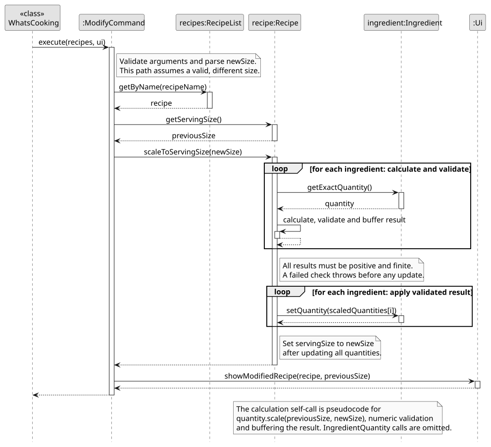
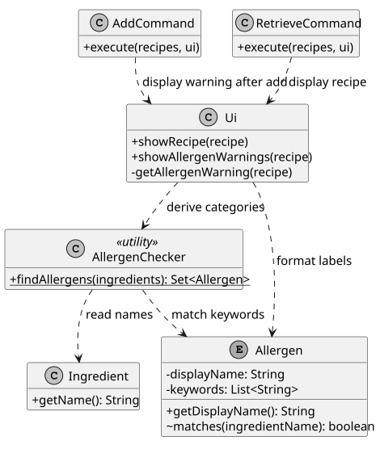
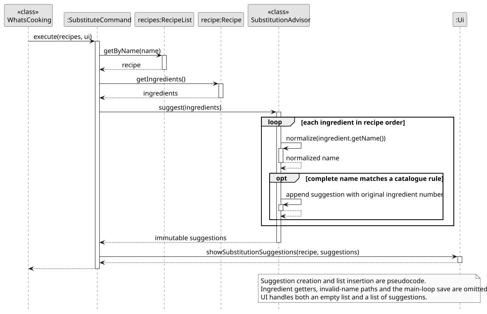

# CAO JINGYUAN - Project Portfolio Page

## 1. Overview and Summary of Contributions

### Overview

WhatsCooking is a Java command-line recipe manager for home cooks who prefer typing. It stores and
searches recipes, scales ingredient quantities, flags possible allergens, suggests ingredient
alternatives and tracks home stock.

### Summary of Contributions

**Code contributed:** [RepoSense](https://nus-cs2113-ay2627-s1.github.io/tp-dashboard/?search=littlecrawler&breakdown=true).

#### Enhancements implemented

* **Structured ingredients:** Implemented quantity/unit/name parsing and integrated it with `add`,
  providing the ingredient model used by later scaling. Added tests for accepted formats and invalid
  input ([issue #13](https://github.com/AY2627S1-CS2113-W14-3/tp/issues/13),
  [PR #15](https://github.com/AY2627S1-CS2113-W14-3/tp/pull/15)).
* **Serving-size modification:** Implemented `modify` and the immutable `IngredientQuantity` model.
  Reduced fractions preserve exact calculations across successive resizes within a session; display
  rounding does not feed back into the calculation. Every new quantity is validated before any
  ingredient is updated, so a failed resize leaves the recipe unchanged
  ([issue #20](https://github.com/AY2627S1-CS2113-W14-3/tp/issues/20),
  [PR #22](https://github.com/AY2627S1-CS2113-W14-3/tp/pull/22)).
* **Allergen warnings:** Implemented the nine-category checker and consistent warnings on `add` and
  `retrieve`. Whole-word matching avoids matches such as `egg` in `eggplant`; deduplication and a
  fixed category order make output predictable. Results are derived from current ingredient names
  without changing the save format
  ([issue #38](https://github.com/AY2627S1-CS2113-W14-3/tp/issues/38),
  [PR #39](https://github.com/AY2627S1-CS2113-W14-3/tp/pull/39)).
* **Ingredient alternatives:** Implemented `substitute` with a limited complete-name catalogue,
  immutable suggestions and cooking caveats. Complete-name matching prevents compound ingredients
  such as `coconut milk` from receiving the `milk` rule. Suggestions preserve recipe quantities,
  fields and ingredient numbering
  ([issue #54](https://github.com/AY2627S1-CS2113-W14-3/tp/issues/54),
  [PR #56](https://github.com/AY2627S1-CS2113-W14-3/tp/pull/56), merged).

#### Testing and code quality

* Wrote JUnit tests for ingredient parsing/display, exact scaling, allergen matching, substitution,
  command validation and the `add s/` / `modify` contract. CLI workflow tests launch real Java processes
  in isolated directories to check console output, errors, save/restart and recipe-data preservation.
* Addressed the TA's three `Ingredient` readability comments by replacing parsing indices with named
  constants and expanding unit-assignment ternaries, while preserving behavior
  ([issue #37](https://github.com/AY2627S1-CS2113-W14-3/tp/issues/37),
  [PR #39](https://github.com/AY2627S1-CS2113-W14-3/tp/pull/39)). Added assertions and logging to my features.

<div class="ppp-page-break" style="break-before: page; page-break-before: always;"></div>

### Summary of Contributions (continued)

#### Contributions to the User Guide

Wrote the [`modify`](../UserGuide.md#modifying-a-recipe-modify),
[allergen-warning](../UserGuide.md#built-in-allergen-warnings) and
[`substitute`](../UserGuide.md#viewing-ingredient-alternatives-substitute) sections, including command
formats, examples, errors and limitations. Also wrote the initial `view` usage and empty-list
documentation ([PR #22](https://github.com/AY2627S1-CS2113-W14-3/tp/pull/22)).

#### Contributions to the Developer Guide

Documented the [serving-size model](../DeveloperGuide.md#serving-size-model),
[allergen design](../DeveloperGuide.md#allergen-checking-design) and
[substitution design](../DeveloperGuide.md#ingredient-substitution-design), with implementation flows,
validation, alternatives, limitations and manual tests. Added a class diagram and a sequence diagram
for each of these three features, updated their notation after review, and separated Design from
Implementation ([PR #39](https://github.com/AY2627S1-CS2113-W14-3/tp/pull/39),
[issue #55](https://github.com/AY2627S1-CS2113-W14-3/tp/issues/55),
[PR #56](https://github.com/AY2627S1-CS2113-W14-3/tp/pull/56)). Selected extracts follow in Parts 2 and 3.

#### Contributions to team tasks and reviews

* Updated the About Us page and formatting
  ([PR #7](https://github.com/AY2627S1-CS2113-W14-3/tp/pull/7)).
  Tracked my implementation and documentation work using the linked issues and PRs.
* Reviewed and merged teammates' PRs
  [#11](https://github.com/AY2627S1-CS2113-W14-3/tp/pull/11),
  [#12](https://github.com/AY2627S1-CS2113-W14-3/tp/pull/12),
  [#14](https://github.com/AY2627S1-CS2113-W14-3/tp/pull/14),
  [#16](https://github.com/AY2627S1-CS2113-W14-3/tp/pull/16),
  [#24](https://github.com/AY2627S1-CS2113-W14-3/tp/pull/24),
  [#26](https://github.com/AY2627S1-CS2113-W14-3/tp/pull/26),
  [#41](https://github.com/AY2627S1-CS2113-W14-3/tp/pull/41),
  [#48](https://github.com/AY2627S1-CS2113-W14-3/tp/pull/48) and
  [#49](https://github.com/AY2627S1-CS2113-W14-3/tp/pull/49).
  Also merged the UML fixes in [PR #57](https://github.com/AY2627S1-CS2113-W14-3/tp/pull/57).
* Gave actionable review feedback on
  [retrieval integer overflow](https://github.com/AY2627S1-CS2113-W14-3/tp/pull/14#discussion_r4226851534),
  [runtime checks alongside assertions](https://github.com/AY2627S1-CS2113-W14-3/tp/pull/26#discussion_r4261657294)
  and [stock-list encapsulation](https://github.com/AY2627S1-CS2113-W14-3/tp/pull/41#discussion_r4356811269).
  For stock expiry, identified
  [mutation before failed removal](https://github.com/AY2627S1-CS2113-W14-3/tp/pull/48#discussion_r4390265577),
  [floating-point residual batches](https://github.com/AY2627S1-CS2113-W14-3/tp/pull/48#discussion_r4390279801)
  and [incorrect DG expectations](https://github.com/AY2627S1-CS2113-W14-3/tp/pull/48#discussion_r4390315672).

#### Contributions beyond the project team

Gave eight inline DG comments on 28 October across MishMash
([review](https://github.com/NUS-CS2113-AY2627-S1/tp/pull/15#pullrequestreview-5678828471),
[fourth comment](https://github.com/NUS-CS2113-AY2627-S1/tp/pull/15#discussion_r4399160912))
and CakeQueue
([review](https://github.com/NUS-CS2113-AY2627-S1/tp/pull/6#pullrequestreview-5678750361),
[fourth comment](https://github.com/NUS-CS2113-AY2627-S1/tp/pull/6#discussion_r4399189385)).
The feedback covered diagram readability, missing algorithm/storage explanations, command consistency
and state transitions. Also reported missing diagrams in
[GameVault](https://github.com/NUS-CS2113-AY2627-S1/tp/pull/19#pullrequestreview-5678692505).

**AI assistance:** I used Codex (OpenAI) to help generate and revise code, tests, documentation, diagrams
and this PPP. I defined the requirements, made the final design decisions, and reviewed, understood,
adapted and tested the AI-assisted work. See the
[Developer Guide acknowledgements](../DeveloperGuide.md#acknowledgements) for the feature scope.

<div class="ppp-page-break" style="break-before: page; page-break-before: always;"></div>

## 2. Contributions to the User Guide - Extracts

Selected passages from my guide sections. The linked full sections provide the remaining examples and details.

### 2.1 Modifying a recipe: `modify`

Source: [User Guide - modify](../UserGuide.md#modifying-a-recipe-modify).

Changes the serving size of an existing recipe and automatically scales all ingredient quantities proportionally.

Format: `modify RECIPE_NAME s/NEW_SERVING_SIZE`

* `NEW_SERVING_SIZE` must be a positive integer, such as `1`, `2`, or `3`.
  Zero, negative numbers, decimal numbers, and non-numeric values are not accepted.

* Rounding affects only the displayed values. The application stores exact ingredient quantities internally,
  so rounding for display does not affect subsequent calculations **within the current session**.
  Saving and restarting stores/reloads decimal approximations, so exact fraction round trips are not
  guaranteed across restarts.

Each example below starts with an `Egg Taco` recipe that serves **2** and contains **2 eggs**, **4 tortillas**,
and **100 g cheese**.

`modify Egg Taco s/4`

Changes the serving size from 2 to 4 and doubles all ingredient quantities.

Expected output:

```text
Serving size of Egg Taco has been updated from 2 to 4.
Updated ingredients:
1. 4 eggs
2. 8 tortillas
3. 200 g cheese
```

### 2.2 Built-in allergen warnings

Source: [User Guide - allergen warnings](../UserGuide.md#built-in-allergen-warnings).

After a successful `add`, and when you `retrieve` a recipe, WhatsCooking checks the recorded ingredient
names against the fixed English keyword list below. No extra command or allergy profile is needed.

*The keyword table referred to in this passage is omitted; see the linked full section.*

If no keyword matches, or a recipe has no ingredients, no warning is printed. **Absence of a warning
does not mean a recipe is allergen-free.** The checker cannot identify every allergen, hidden ingredients,
cross-contact or ingredients named in other languages. It also cannot understand substitutions or
negation: `coconut milk`, `peanut butter` and `egg-free mix` can produce extra warnings because their
names contain listed keywords. Check the actual ingredient labels and suitability yourself.

### 2.3 Viewing ingredient alternatives: `substitute`

Source: [User Guide - substitute](../UserGuide.md#viewing-ingredient-alternatives-substitute).

Shows possible alternatives for supported ingredients in an existing recipe.

Format: `substitute RECIPE_NAME`

* The command does not swap ingredients or calculate replacement amounts. Your original recipe,
  serving size and stock stay unchanged. Check a suitable recipe before using an alternative.

**An alternative can contain other allergens.** Check all relevant allergies, product labels and
cross-contact. A suggestion, or the absence of one, does not establish that any food is safe.
The command cannot evaluate a recipe's cooking method, an allergy profile or nutritional needs.

<div class="ppp-page-break" style="break-before: page; page-break-before: always;"></div>

## 3. Contributions to the Developer Guide - Extracts

Selected passages and diagrams from my design and implementation sections. Wording is preserved; formatting is adjusted and omissions are between extracts.

### 3.1 Serving-size modification: exact values and atomic updates

Source: [Developer Guide - modify](../DeveloperGuide.md#serving-size-modification-modify).

An ingredient's quantity is an `IngredientQuantity`, represented by positive `BigInteger` numerator
and denominator fields. Decimal input is converted through `BigDecimal` without first rounding the
stored value to a `double`. Scaling creates a new fraction:

```text
new numerator   = current numerator   * new serving size
new denominator = current denominator * current serving size
```



[Editable PlantUML source](../diagrams/modify-serving-size.puml).

The two loops prevent a later invalid quantity from leaving earlier ingredients partly resized.
For example, if the last ingredient overflows, the exception occurs before any quantity or serving
size is changed.

<div class="ppp-page-break" style="break-before: page; page-break-before: always;"></div>

### 3.2 Allergen checking: reusable matching and derived results

Sources: [Allergen checking design](../DeveloperGuide.md#allergen-checking-design) and [matching rules](../DeveloperGuide.md#matching-rules).

The feature separates matching from console formatting so the same rules can be reused and tested
without running the application loop.



[Editable PlantUML source](../diagrams/allergen-classes.puml).

No allergen flag is stored in `Recipe` or in the save file. `AllergenChecker.findAllergens` derives a
new result from the current ingredient names each time it is called. Consequently, recipes loaded by
`Storage` receive the same check as newly created recipes, and scaling quantities does not invalidate
the result. Existing files remain compatible because the feature adds no persistent fields. The
returned set is unmodifiable; callers cannot mutate a result or use it to change a recipe.

`Allergen.matches` converts an ingredient name to lowercase using `Locale.ROOT`, then replaces runs
of non-letter/non-digit characters with a space. Using a fixed locale makes matching independent of
the computer's language settings. Punctuation and repeated whitespace therefore separate words;
for example, `BRAZIL-NUTS` becomes `brazil nuts`.

The normalized name and each keyword are compared with spaces around their boundaries. This allows
`roasted peanuts` to match `peanuts` without allowing `egg` to match `eggplant`. Singular and plural
forms are listed explicitly; the implementation does not guess word stems or interpret ingredient
semantics. An ingredient may match several categories, and several ingredients may match the same
category. An `EnumSet` removes duplicates and preserves category declaration order, producing stable
output such as `Possible allergens: milk, eggs. Check ingredient labels.`

<div class="ppp-page-break" style="break-before: page; page-break-before: always;"></div>

### 3.3 Ingredient alternatives: conservative advice without mutation

Sources: [Ingredient substitution design](../DeveloperGuide.md#ingredient-substitution-design) and [lookup and command flow](../DeveloperGuide.md#lookup-and-command-flow).

The `substitute` command offers cooking ideas without modifying recipe ingredients or quantities.
It shares the existing recipe model but uses its own conservative catalogue. A broad keyword match
is useful for a caution, whereas a replacement suggestion needs a more specific ingredient identity.



[Editable PlantUML source](../diagrams/substitution-sequence.puml).

3. `SubstitutionAdvisor.suggest` visits the ingredients in recipe order. It lowercases each name
   with `Locale.ROOT`, strips surrounding whitespace, and collapses runs of whitespace or hyphens
   to one space. It then compares the complete result with each rule's explicit aliases.
4. For a matching rule, it creates one `SubstitutionSuggestion` with the original 1-based ingredient
   number and the rule's alternative and usage note. Unsupported names are skipped; separate
   ingredient entries retain separate suggestions, even if their names repeat.
5. The advisor returns `List.copyOf(suggestions)`. `Ui` displays the result, handles an empty list,
   and states that the recipe and quantities have not changed.

This permits `WHOLE WHEAT-FLOUR` to match `whole wheat flour`, while preventing `coconut milk` from
using the `milk` rule and `peanut butter` from using the `butter` rule. An empty result only means that
the catalogue has no entry. It must never be displayed as an allergy-safety result.

Complete-name matching was chosen over substring/category matching to avoid applying a cooking
substitution to a different compound ingredient. The cost is intentionally limited coverage; the
command supports six rule groups, not all nine warning categories. Maintaining an explicit catalogue
makes each alias and caveat reviewable without adding a remote service or runtime library.
